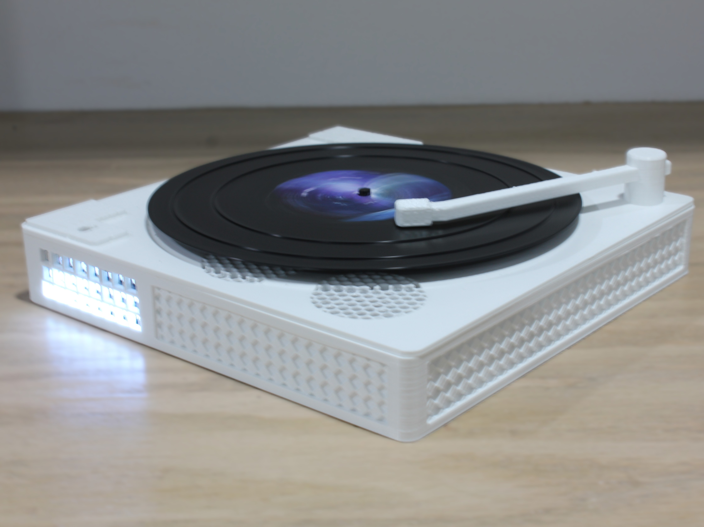
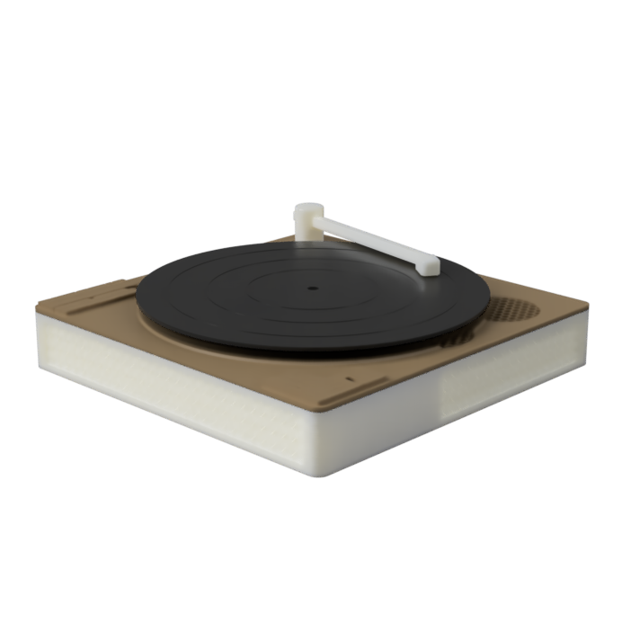
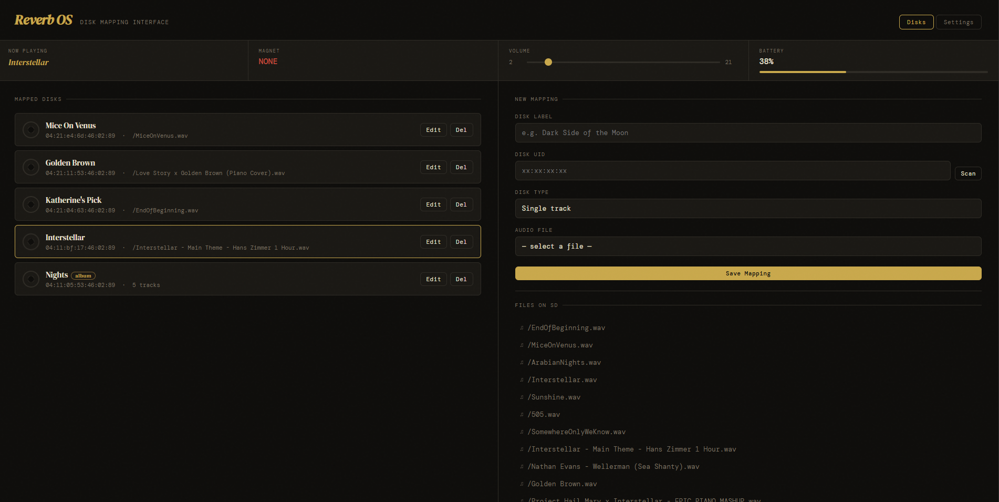
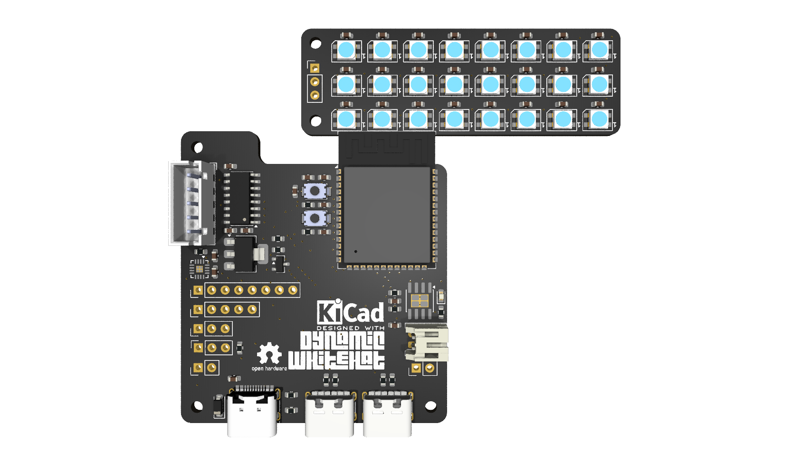
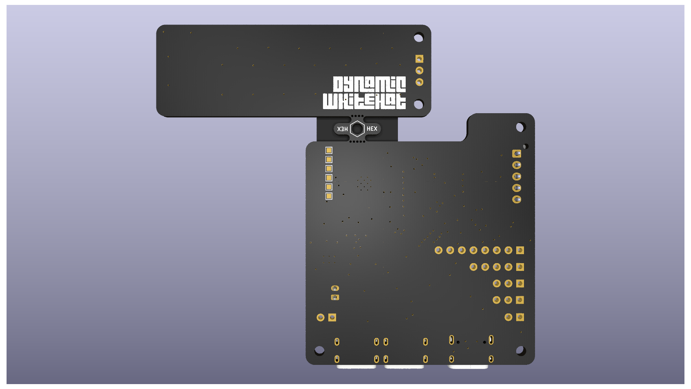

# Reverb

**A custom ESP32 record player. Place a disk and it plays.**

 

The finished build: RFID-tagged disks, a working stylus, and a 3x8 NeoPixel visualizer.

> [!WARNING]
> This PCB has many faults that required me to rewire several connections by hand. I strongly advise against ordering the PCBs in this repository if you don't have prior experience. I may or may not update the files in the future.

---

## Overview

Reverb is a custom record player. Each 3D printed disk has an RFID sticker inside it that maps to a song, so playback feels like the real thing. The original idea is from [AKZ Dev on YouTube](https://www.youtube.com/watch?v=fBjv4E7mpA4).

### Features

| | |
|---|---|
| **Brains** | ESP32-S3-WROOM-1 module (Wi-Fi + Bluetooth) |
| **Audio** | MAX98357A I2S amplifier driving an 8Ω 10W speaker |
| **Disks** | RFID reader maps each disk to a song |
| **Stylus** | Working tonearm that starts and stops music |
| **Visualizer** | 3x8 SK6812 Mini NeoPixel audio visualizer |
| **Gestures** | PAJ7620U2 sensor for touch-free volume control (WIP) |
| **Power out** | 2x USB, 3.0 A at 5V |
| **Playback** | Single and playlist modes |
| **Web UI** | Map disks to songs from your browser (Reverb OS) |

---

## Gallery

### Design

<table align="center">
  <tr>
    <td align="center" width="50%">
       
      <b>CAD render</b>
    </td>
    <td align="center" width="50%">
       
      <b>Reverb OS web interface</b>
    </td>
  </tr>
  <tr>
    <td align="center" width="50%">
       
      <b>PCB front</b>
    </td>
    <td align="center" width="50%">
       
      <b>PCB back</b>
    </td>
  </tr>
</table>

### Schematic and Layout

   
  <b>Full schematic</b>

<table align="center">
  <tr>
    <td align="center" width="50%">
       
      <b>PCB layout, front</b>
    </td>
    <td align="center" width="50%">
       
      <b>PCB layout, back</b>
    </td>
  </tr>
  <tr>
    <td align="center" width="50%">
       
      <b>Board outline</b>
    </td>
    <td align="center" width="50%">
       
      <b>Board overview</b>
    </td>
  </tr>
</table>

---

## Why I Designed This

I saw [this video](https://www.youtube.com/watch?v=fBjv4E7mpA4) on YouTube one day and wanted to make my own version. The original used a Raspberry Pi Zero with several modules. I wanted to improve on it with a custom ESP32-based PCB, a built-in speaker, and a few extra features. I also found another video about an ESP32 speaker with an audio visualizer, so I added one with a 3x8 NeoPixel array.

Along the way I got better at routing PCBs and developed a sense for good-looking layouts.

---

## How It Works

| Part | Role |
|---|---|
| **ESP32-S3-WROOM-1** | Main controller. Runs the playback logic and serves the web interface. |
| **SD card** | Holds the WAV files and the HTML file the ESP32 serves. |
| **MAX98357A** | I2S amplifier wired to an 8Ω 10W speaker, so audio plays from the player itself. |
| **SK6812 Mini 3x8 array** | Mounted on the front of the case behind a thin wall. Visualizes the audio. |
| **PAJ7620U2** | Gesture sensor under the REVERB logo. Handles volume, track skipping, and more. |
| **RC522 RFID reader** | The heart of the design. Reads the RFID stickers inside the disks and maps each one to a song. |

---

## Bill of Materials

| Item | Qty | Link | Price | Comment |
|---|---|---|---|---|
| JLCPCB Order | 1 | Quote | $23.62 | PCB + stencil |
| LCSC Order | 1 | See LCSC BOM below | $28.00 | PCB parts |
| Stepper Motor | 1 | [AliExpress](https://www.aliexpress.us/item/2251832816516054.html) | $2.61 | |
| RC522 RFID Reader | 1 | [AliExpress](https://www.aliexpress.us/item/3256805262944828.html) | $1.46 | |
| RFID Tag | 1 pack of 30 | [AliExpress](https://www.aliexpress.us/item/3256807346917359.html) | $2.92 | |
| PAJ7620U2 Gesture Sensor | 1 | [AliExpress](https://www.aliexpress.us/item/3256803918726745.html) | $5.09 | |
| Speaker | 1 | [AliExpress](https://www.aliexpress.us/item/3256806860528919.html) | $8.12 | |
| Power Switch | 1 pack of 5 | [AliExpress](https://www.aliexpress.us/item/3256803938436290.html) | $2.12 | |
| SD Card Reader | 1 | [AliExpress](https://www.aliexpress.us/item/3256805115720436.html) | $0.83 | |
| US5881 Hall Effect Sensor | 1 pack of 10 | [AliExpress](https://www.aliexpress.us/item/3256806135616417.html) | $1.82 | |
| M2-M5 Screw Set | 1 | [Amazon](https://www.amazon.com/mxuteuk-Assortment-Machine-Washers-Printing/dp/B0FM3G5K6H/?th=1) | $9.99 | From Amazon, as AliExpress doesn't sell assortments |
| | | **Total** | **$86.58** | |

<b>LCSC Bill of Materials</b> (click to expand)

 

| Description | Qty | Mfr # | Min. Order | Unit Price (USD) | Ext. Price (USD) | LCSC # |
|---|---|---|---|---|---|---|
| 100nF ±10% 50V Ceramic Capacitor X7R 0603 | 28 | CC0603KRX7R9BB104 | 100 | 0.0021 | 0.21 | [C14663](https://www.lcsc.com/product-detail/C14663.html) |
| 10kΩ ±1% 100mW 0603 Thick Film Resistor | 3 | 0603WAF1002T5E | 100 | 0.0011 | 0.11 | [C25804](https://www.lcsc.com/product-detail/C25804.html) |
| 10uF ±10% 10V Ceramic Capacitor X5R 0603 | 5 | CL10A106KP8NNNC | 50 | 0.0065 | 0.33 | [C19702](https://www.lcsc.com/product-detail/C19702.html) |
| 1MΩ ±1% 100mW 0603 Thick Film Resistor | 2 | 0603WAF1004T5E | 100 | 0.0011 | 0.11 | [C22935](https://www.lcsc.com/product-detail/C22935.html) |
| Diode Independent 40V 1A SOD-123 | 1 | K1N5819HW-7-F | 50 | 0.0133 | 0.67 | [C2891704](https://www.lcsc.com/product-detail/C2891704.html) |
| 1kΩ ±1% 100mW 0603 Thick Film Resistor | 1 | 0603WAF1001T5E | 100 | 0.0012 | 0.12 | [C21190](https://www.lcsc.com/product-detail/C21190.html) |
| 1uF ±10% 50V Ceramic Capacitor X5R 0603 | 1 | CL10A105KB8NNNC | 50 | 0.0056 | 0.28 | [C15849](https://www.lcsc.com/product-detail/C15849.html) |
| 22uF ±20% 6.3V Ceramic Capacitor X5R 0603 | 1 | CL10A226MQ8NRNC | 20 | 0.0094 | 0.19 | [C59461](https://www.lcsc.com/product-detail/C59461.html) |
| 4.7kΩ ±1% 100mW 0603 Thick Film Resistor | 4 | 0603WAF4701T5E | 100 | 0.0011 | 0.11 | [C23162](https://www.lcsc.com/product-detail/C23162.html) |
| 4.7uF ±10% 16V Ceramic Capacitor X5R 0603 | 2 | CL10A475KO8NNNC | 10 | 0.0102 | 0.10 | [C19666](https://www.lcsc.com/product-detail/C19666.html) |
| 5.1kΩ ±1% 100mW 0603 Thick Film Resistor | 2 | 0603WAF5101T5E | 100 | 0.0011 | 0.11 | [C23186](https://www.lcsc.com/product-detail/C23186.html) |
| 634kΩ ±1% 100mW 0603 Thick Film Resistor | 1 | 0603WAF6343T5E | 100 | 0.0007 | 0.07 | [C65831](https://www.lcsc.com/product-detail/C65831.html) |
| 3.3V LDO Regulator SOT-223 (AP7361C-33E-13) | 1 | AP7361C-33E-13 | 5 | 0.2779 | 1.39 | [C500795](https://www.lcsc.com/product-detail/C500795.html) |
| Diode Array 1 Pair Common Cathode 30V 200mA SOT-23 | 1 | BAT54C | 50 | 0.0095 | 0.48 | [C727125](https://www.lcsc.com/product-detail/C727125.html) |
| JST PH 2-pin 2mm Pitch Right Angle Header | 1 | S2B-PH-K-S(LF)(SN) | 20 | 0.0355 | 0.71 | [C173752](https://www.lcsc.com/product-detail/C173752.html) |
| JST XH 5-pin 2.5mm Pitch Through Hole Header | 1 | B5B-XH-A(LF)(SN) | 5 | 0.0826 | 0.41 | [C157991](https://www.lcsc.com/product-detail/C157991.html) |
| ESP32-S3-WROOM-1 N8R8 (2.4GHz, PCB antenna) | 1 | ESP32-S3-WROOM-1-N8R8 | 1 | 4.9347 | 4.93 | [C2913201](https://www.lcsc.com/product-detail/C2913201.html) |
| MAX98357A Class D Audio Amplifier TQFN-16-EP (3x3) | 1 | MAX98357AETE+T | 1 | 1.3216 | 1.32 | [C910544](https://www.lcsc.com/product-detail/C910544.html) |
| SK6812 Mini Addressable LED, SMD 3.7x3.5mm | 24 | SK6812SMINI | 30 | 0.0617 | 1.85 | [C7423118](https://www.lcsc.com/product-detail/C7423118.html) |
| Tactile Switch SPST 160gf 2mm SMD | 2 | TS-1088-AR02016 | 10 | 0.0426 | 0.43 | [C720477](https://www.lcsc.com/product-detail/C720477.html) |
| TP4056 Li-ion/Polymer Charger ESOP-8 | 1 | TP4056 | 5 | 0.091 | 0.46 | [C382139](https://www.lcsc.com/product-detail/C382139.html) |
| ULN2003A Bipolar Transistor Array SOIC-16 | 1 | ULN2003ADR | 5 | 0.1121 | 0.56 | [C7512](https://www.lcsc.com/product-detail/C7512.html) |
| USB-C Receptacle, 6 Position, SMD | 2 | TYPE-C-31-M-17 | 5 | 0.1789 | 0.89 | [C283540](https://www.lcsc.com/product-detail/C283540.html) |
| USB-C Receptacle, 16 Position, SMD | 1 | TYPE-C-31-M-12 | 5 | 0.1908 | 0.95 | [C165948](https://www.lcsc.com/product-detail/C165948.html) |
| 5kΩ Thin Film Resistor ±0.1% 0603 | 1 | TR0603B5K00P0525Z | 20 | 0.028 | 0.56 | [C3202451](https://www.lcsc.com/product-detail/C3202451.html) |
| 400mΩ ±1% 100mW 0603 Thick Film Resistor | 1 | FRL0603FR400TS | 100 | 0.0035 | 0.35 | [C5126047](https://www.lcsc.com/product-detail/C5126047.html) |
| | | | | **Combined Price** | **$18.23** | |
| | | | | **Shipping** | **$9.99** | |
| | | | | **Total Price** | **$27.68** | |

---

Original concept by <a href="https://www.youtube.com/watch?v=fBjv4E7mpA4">AKZ Dev</a>. Designed and built with KiCad and a lot of rewiring.

